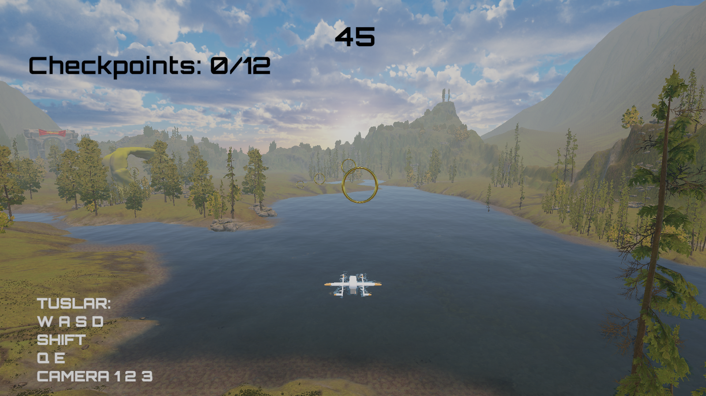
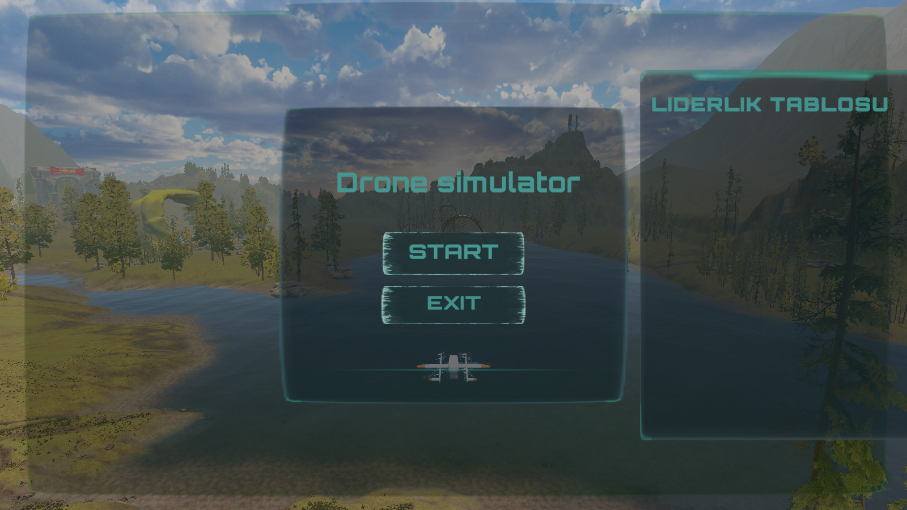

# Drone Simulator

**A physics-driven drone time trial built with Unity and C#.** Fly through a terrain course, collect 12 checkpoints within 45 seconds, and compete against your own best completion times.

[](ProjectSettings/ProjectVersion.txt)
[](Assets/Scripts/Drone.cs)
[](Packages/manifest.json)
[](#project-status)
[](LICENSE)

[Türkçe README](README.tr.md) · [Architecture](docs/ARCHITECTURE.md) · [Asset credits](THIRD_PARTY_NOTICES.md)



## The experience

The challenge is simple: steer the drone through every checkpoint before the countdown ends. Manage altitude, turn through the course, use boost to make up time, and switch camera perspectives as you fly. A successful run can be saved under a player name to the local leaderboard.

- **Physics-driven flight:** Rigidbody acceleration, horizontal and vertical damping, yaw control, and a configurable boost.
- **Responsive presentation:** smoothed visual banking, animated propellers, and checkpoint sound and particle feedback.
- **A complete run loop:** start menu, countdown and checkpoint HUD, pause/resume, win/lose screen, and restart.
- **Three camera modes:** onboard, mouse-controlled orbit, and follow.
- **Persistent local scores:** named completion times stored as JSON in `PlayerPrefs`, ranked fastest first.

## My contribution

**Azra Ömeroğlu** — gameplay programming and Unity scene integration. The project demonstrates how I connect input, physics, camera behavior, game states, UI, and persistence into a playable C# prototype. Third-party visual and audio resources are credited separately in [the asset notices](THIRD_PARTY_NOTICES.md).

> **CV summary:** Developed a Unity/C# drone time-trial prototype with physics-driven movement, event-driven input, multiple camera modes, state-based UI, and persistent local score tracking.

## Play in the Unity Editor

1. Install [Git LFS](https://git-lfs.com/) and clone this repository:

   ```sh
   git lfs install
   git clone https://github.com/omerovicqueen/drone-simulator.git
   cd drone-simulator
   git lfs pull
   ```

2. Install **Unity Editor 6000.3.8f1** through Unity Hub.
3. In Unity Hub, add the cloned `drone-simulator` folder as an existing project and open it with that editor version.
4. Let Unity restore the packages and finish importing the assets.
5. Open **`Assets/Scenes/Main.unity`**, enter Play mode, and click **START**.

The scene configures **12 checkpoints**, a **45-second time limit**, and **3× boost acceleration**. Checkpoints can be collected in any order. After winning, enter a name and click **SAVE** to record your time.

Keep **Active Input Handling** set to **Both** under `Edit → Project Settings → Player → Other Settings`. Flight controls use the Input System; the orbit camera reads the legacy mouse axes. The checked-in project already uses this setting.

## Controls

| Input | Action |
| --- | --- |
| W / A / S / D | Move forward / left / backward / right |
| Space | Ascend |
| Ctrl | Descend |
| Q / E | Rotate left / right |
| Hold Shift | Boost |
| Esc | Pause / resume |
| 1 | Onboard camera |
| 2 + mouse movement | Orbit camera |
| 3 | Follow camera |

Bindings are defined in [DroneActions.inputactions](Assets/Inputs/DroneActions.inputactions).

## Explore the implementation

| System | Source | What to look for |
| --- | --- | --- |
| Flight | [Drone.cs](Assets/Scripts/Drone.cs) | Fixed-step forces, damping, yaw, boost, visual tilt |
| Input | [InputManager.cs](Assets/Scripts/InputManager.cs) | Input Action callbacks exposed as C# events |
| Run lifecycle | [GameManager.cs](Assets/Scripts/GameManager.cs) | Onboarding, gameplay, pause, completion, and reset |
| Checkpoints | [Checkpoint.cs](Assets/Scripts/Checkpoint.cs) | Trigger handling, feedback, and completion checks |
| Cameras | [CameraControl](Assets/Scripts/CameraControl) | Mode selection, target attachment, and orbit behavior |
| Interface | [UIManager.cs](Assets/Scripts/UIManager.cs) · [UI panels](Assets/Scripts/UI) | State-driven screens, countdown, score entry |
| Persistence | [PlayerScoreBoardManager.cs](Assets/Scripts/PlayerScoreBoardManager.cs) | JSON serialization and local ranking |

The core stack is **Unity 6**, **C#**, **URP**, **Unity Input System**, **uGUI/TextMeshPro**, and **ProBuilder**. Exact package versions are recorded in [manifest.json](Packages/manifest.json) and [packages-lock.json](Packages/packages-lock.json). Camera behavior is implemented by the project's own scripts.

See [ARCHITECTURE.md](docs/ARCHITECTURE.md) for the runtime flow and source layout.

## Project status

This is a single-player, keyboard-and-mouse **portfolio prototype** with arcade flight behavior. Scores are local to the player's machine. The current camera tuning and flight parameters are intended for iteration; the project does not model real-world drone aerodynamics. No packaged release is included.

The repository contains the Unity project sources and required scene assets. Large terrain textures and terrain data use Git LFS; the source assets occupy approximately 2.2 GB. Clone with Git LFS to download the actual assets. Unity rebuilds import caches on first open, so the initial import can take time.

<details>
<summary>View the start menu</summary>



</details>

## License and credits

Original gameplay code is available under the [MIT License](LICENSE). Third-party assets and package content remain subject to their own licenses; the MIT license does not relicense them. See [THIRD_PARTY_NOTICES.md](THIRD_PARTY_NOTICES.md) before reusing or redistributing those resources.

Created by [Azra Ömeroğlu](https://github.com/omerovicqueen).
