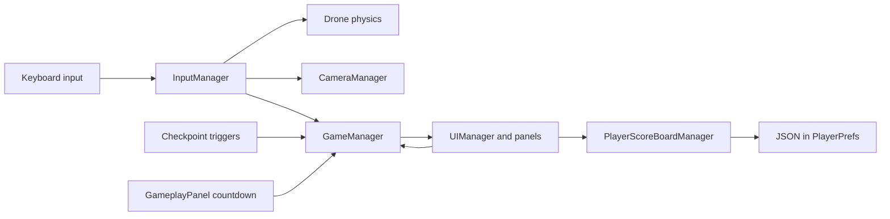
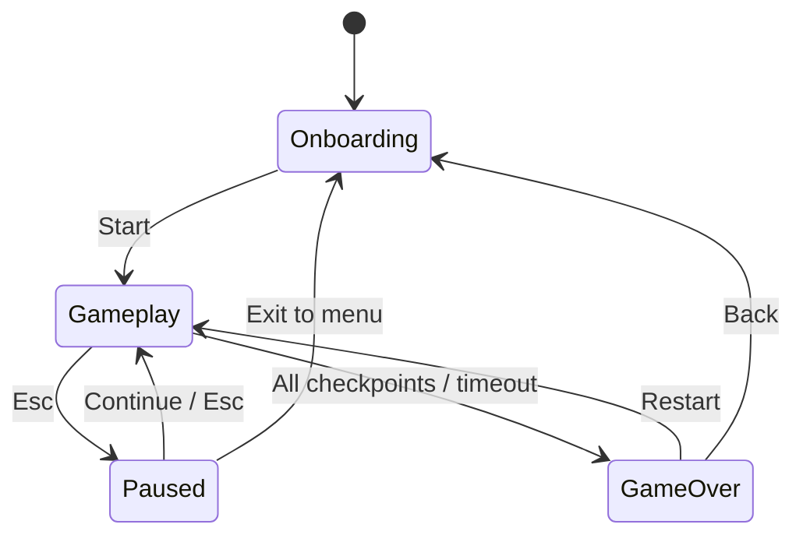

# Architecture

[Back to the project](../README.md)

Drone Simulator separates flight, input, run state, cameras, UI, and local score persistence into focused `MonoBehaviour` components. The playable entry point is [`Assets/Scenes/Main.unity`](../Assets/Scenes/Main.unity).

## Runtime flow



## Responsibilities

| Component | Responsibility |
| --- | --- |
| [InputManager](../Assets/Scripts/InputManager.cs) | Converts Input System callbacks into C# events for movement, boost, pause, and camera selection. |
| [Drone](../Assets/Scripts/Drone.cs) | Applies Rigidbody acceleration and damping in `FixedUpdate`, controls yaw, and smooths the model's visual tilt. |
| [PropellersRotation](../Assets/Scripts/PropellersRotation.cs) | Rotates the configured propeller transforms while the game is in the gameplay state. |
| [GameManager](../Assets/Scripts/GameManager.cs) | Owns the run state, drone reset, starting position, checkpoint collection, and success/failure result. |
| [Checkpoint](../Assets/Scripts/Checkpoint.cs) | Handles collection feedback, disables a collected target, and requests a completion check. |
| [CameraManager / CameraPoint](../Assets/Scripts/CameraControl) | Selects the active camera point and implements onboard, orbit, and follow behavior. |
| [UIManager](../Assets/Scripts/UIManager.cs) | Activates the menu, gameplay, pause, or completion screen in response to state changes. |
| [GameplayPanel](../Assets/Scripts/UI/GameplayPanel.cs) | Updates the countdown and checkpoint display, records elapsed time, and reports timeout. |
| [CompletePanel](../Assets/Scripts/UI/CompletePanel.cs) | Displays the result, handles restart/menu navigation, and saves a named successful run. |
| [PlayerScoreBoardManager](../Assets/Scripts/PlayerScoreBoardManager.cs) | Serializes score entries to JSON, stores them in `PlayerPrefs`, and sorts the leaderboard by completion time. |

## Run lifecycle



The gameplay state enables drone physics. Starting a fresh run restores the drone's starting transform and re-enables checkpoint targets. Pausing makes the drone kinematic and preserves the countdown; resuming clears its velocity before re-enabling physics. Completing every checkpoint records success; reaching zero on the countdown records failure.

The Main scene assigns 12 checkpoints and overrides `GameplayPanel.startTime` to 45 seconds. Boost multiplies horizontal and vertical acceleration by 3. These are scene settings rather than hard-coded course values.

## Implementation choices

- **Input and movement are separated.** Consumers subscribe to `InputManager` events; the Rigidbody work runs at the physics update rate.
- **Physics and appearance are separated.** Translation uses acceleration forces, while visual banking rotates the configured model transform.
- **Screens follow game state.** `GameManager` emits state changes and `UIManager` selects the corresponding panel. The gameplay panel currently refreshes checkpoint counts each frame.
- **Scores are intentionally local.** `JsonUtility` serializes the list and `PlayerPrefs` persists it under the `ScoreBoard` key. There is no server or account dependency.
- **Scene references configure the prototype.** Managers, drone, UI elements, camera targets, and checkpoint dependencies are assigned through the scene or prefab Inspector.

The project uses both input backends: Input System actions drive flight and shortcuts, while the orbit camera reads `Mouse X` / `Mouse Y` through the legacy input API. `Active Input Handling = Both` is therefore part of the checked-in setup.

## Source layout

```text
Assets/
├── Inputs/DroneActions.inputactions   # Flight and shortcut bindings
├── Scenes/Main.unity                # Playable course and wired components
├── Scripts/
│   ├── Drone.cs                     # Flight controller
│   ├── GameManager.cs               # Run lifecycle
│   ├── InputManager.cs              # Input events
│   ├── Checkpoint.cs                # Collection and feedback
│   ├── PlayerScoreBoardManager.cs    # Local persistence
│   ├── CameraControl/               # Camera modes
│   └── UI/                          # Screen behavior
└── Settings/                        # Rendering configuration
Packages/                            # Package manifest and lock file
ProjectSettings/                     # Editor, input, and build configuration
```

## Scope and next improvements

The flight controller is designed for an arcade checkpoint challenge, not a real-world flight simulator. The follow camera currently uses a zero scene offset and would benefit from additional tuning. Other useful improvements are input/reference validation, more consistent input-backend use, and automated tests covering run completion, pause/resume, and score persistence.

Third-party resources and their licensing are documented in [THIRD_PARTY_NOTICES.md](../THIRD_PARTY_NOTICES.md). Original gameplay code is covered by [LICENSE](../LICENSE).
